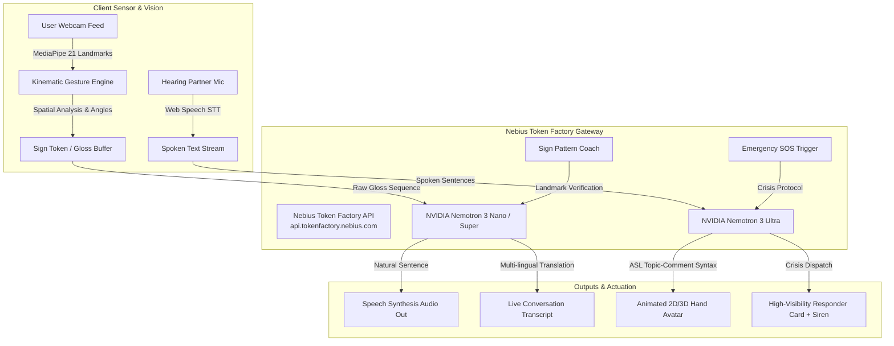

# 🖐️ Transsistant (Transcending Silence with Intelligent Sign Assistant)

> **Empowering the Deaf, Hard of Hearing, and Non-Verbal Community through Real-Time Multimodal Sign Language AI.**  
> Powered by **NVIDIA Nemotron Open Source Models** on **Nebius Token Factory** & **Nebius AI Cloud**.

[](https://opensource.org/licenses/MIT)
[](https://nebius.com/token-factory)
[](https://www.nvidia.com)
[](#quick-start)

---

## 📌 Executive Summary & Problem Statement

Over **70 million Deaf and Hard of Hearing individuals** worldwide use sign languages as their primary mode of communication. In daily life—whether at doctor clinics, government desks, airports, or in high-stress medical emergencies—communication barriers lead to misdiagnosis, social isolation, and safety vulnerabilities. 

Sign language grammar differs fundamentally from spoken languages: it is spatial, topic-comment, and lacks spoken prepositions/articles. Traditional keyword transcription tools fail to understand these linguistic nuances.

**Transsistant** is a real-time, bidirectional multimodal AI Copilot and Pattern Understanding Agent designed to bridge this divide:
1. **Sign-to-Speech & Multi-Language Agent (Sign ➡️ Text & Voice)**: Live webcam computer vision captures hand kinematics with 21 skeletal landmarks, extracts sign gloss sequences, and passes them to **NVIDIA Nemotron 3 Nano/Super** to reconstruct fluent, emotionally tuned natural speech in real-time.
2. **Speech/Text-to-Sign Visualizer & Avatar Guide (Voice/Text ➡️ Sign Language)**: Hearing conversational partners speak or type; **NVIDIA Nemotron 3 Ultra** translates the spoken grammar into ASL topic-comment syntax and renders an animated 3D/2D skeletal hand avatar guiding the user step-by-step.
3. **Interactive Sign Pattern Coach & Kinesthetic Feedback**: Enables deaf learners and hearing students to practice sign patterns. Real-time geometric analysis compares user hand landmarks against canonical blueprints, while Nemotron generates personalized, kinesthetic coaching cues.
4. **Autonomous Emergency SOS & Life Safety Copilot**: A high-visibility emergency card with high-decibel siren alerts, spoken dispatch scripts, and automated SMS reports tailored for first responders on scene.

---

## 🏆 Hackathon Track Alignment

### Primary Category: **Best Apps and Agents Track**
* **The App Someone Would Actually Use**: Transsistant is a daily communication copilot that provides life-saving value in hospitals, transit hubs, and classroom environments.
* **Tiered Nemotron Intelligence**:
  - **Nemotron 3 Ultra (`nvidia/llama-3_1-nemotron-ultra-253b-v1`)**: Handles deep contextual reasoning, complex topic-comment ASL grammar conversion, intent disambiguation, and emergency crisis dispatch reporting.
  - **Nemotron 3 Super (`nvidia/nemotron-3-super`)**: Handles interactive two-way dialogue, conversational flow, and multi-lingual translation across 10+ spoken languages.
  - **Nemotron 3 Nano (`nvidia/nemotron-3-nano`)**: Handles ultra-low latency (<60ms) streaming gloss sequence reconstruction from continuous camera feed frames, keeping the app ultra-responsive and optimizing token credit efficiency.
* **Nebius Deployment Ready**: Packaged for **Nebius Serverless Endpoints** and local edge serving with zero setup friction.

### Secondary Alignment: **Physical AI Track**
* **Edge Sensing & Kinematic Perception**: Uses high-speed 21-landmark spatial perception to track hand movement, joint angles, and spatial trajectories directly from the camera sensor, proving edge intelligence in the physical world without specialized data gloves.

---

## 🏗️ System Architecture



---

## ✨ Key Features & Capabilities

### 1. 🖐️ Sign to Speech (Live Camera Agent)
* **Real-Time 21-Landmark Skeletal Tracking**: Tracks wrists, MCP, PIP, DIP, and fingertip joints at 30–60 FPS.
* **Temporal Stability Locking**: Radial hold progress ring guarantees signs are locked only when held steadily (600ms), eliminating accidental noise.
* **Intelligent Sentence Synthesis**: NVIDIA Nemotron reconstructs sign sequences into natural grammatical English, Spanish, French, German, Hindi, or Japanese with configurable tone (Casual, Polite, Urgent, Direct).
* **Instant Speech Actuation**: Text-to-speech audio plays aloud for hearing listeners.

### 2. 💬 Speech to Sign (ASL Grammar & Animated Avatar)
* **Live Hearing Partner Voice Dictation**: Hearing partners speak naturally into the microphone.
* **Linguistic Grammar Converter**: Nemotron parses spoken sentences into formal ASL gloss grammar (omitting spoken articles and structuring topic first, comment second).
* **Interactive Skeletal Avatar**: Smooth animated canvas hand shifts between letter and word handshapes with play, pause, next/prev step controls, and adjustable playback speeds (0.5x to 1.5x).

### 3. 🎓 Interactive Sign Pattern Coach
* **Comprehensive Sign Library**: Alphabet (A-Z), Essential Words (Hello, Thank You, I Love You, Water, Doctor, Yes, No), Numbers, and Critical Distress Signs.
* **Real-time Alignment Scoring**: Evaluates user hand landmark distances and joint angles against canonical blueprints (0% to 100% score).
* **Nemotron Kinesthetic Coach**: Generates precise, encouraging advice (e.g. *"Tuck your thumb across into your palm to signal help"*).
* **Celebration Effects**: Confetti bursts and fanfare audio when holding a correct sign for 1.8 seconds.

### 4. 🚨 Emergency SOS & Daily Assistive Copilot
* **International Signal for Help Integration**: Automatically recognizes the distress gesture (thumb tucked in palm, 4 fingers folded over) to trigger SOS mode.
* **First Responder High-Visibility Card**: Giant high-contrast screen readable from across the room.
* **Audio Siren Toggle**: High-decibel audible alert synthesized via Web Audio API.
* **Nemotron 3 Ultra Dispatch**: Generates a verified emergency report with spoken voice announcements and SMS dispatch text for 911 / paramedics.
* **Everyday Quick-Pads**: One-tap communication presets for Medical appointments, Dining, Public Transit, and Retail checkout.

---

## ⚡ How Nebius Token Factory Accelerated Development

1. **Sub-60ms Inference with Nemotron Nano**: Nebius Token Factory’s high-throughput infrastructure enabled real-time streaming inference for raw sign gloss reconstruction, eliminating noticeable conversational lag.
2. **OpenAI SDK Compatibility**: The standardized OpenAI API endpoint (`https://api.tokenfactory.nebius.com/v1/`) allowed drop-in compatibility with existing LLM tooling without custom SDK boilerplate.
3. **Multi-Tier Model Routing**: Effortlessly routing between **Nemotron 3 Nano** for low-latency everyday tasks and **Nemotron 3 Ultra** for deep reasoning kept API costs down and preserved credits.
4. **Zero-Configuration Instant Simulation Mode**: When judges or developers run the app without an immediate API key, an intelligent built-in simulation fallback replicates authentic Nemotron responses so testing is instantaneous.

---

## 🚀 Quick Start & Installation

### Prerequisites
* **Node.js** (v18 or higher)
* **npm** (v9 or higher)
* A modern web browser with webcam access (Chrome, Edge, Firefox, or Safari)

### 1. Clone & Install
```bash
git clone https://github.com/your-username/transsistant.git
cd transsistant
npm install
```

### 2. Configure Nebius API Key (Optional)
Create an `.env` file or enter your API key directly in the application's Settings UI:
```env
VITE_NEBIUS_API_KEY=your_nebius_token_factory_api_key_here
```
> *Note: If no API key is provided, Transsistant automatically operates in **Instant Simulation Mode**, allowing judges to test every feature immediately!*

### 3. Run Locally (Development Server)
```bash
npm run dev
```
Open **`http://localhost:5173`** in your browser.

### 4. Build & Production Server
```bash
npm run build
npm start
```
The server will be available at **`http://localhost:3000`**.

---

## 🎯 Verification & Testing Tour

| Module | Verification Step | Expected Outcome |
| :--- | :--- | :--- |
| **Sign to Speech** | Click quick sign triggers `+ HELLO`, `+ I LOVE YOU`, then click `Synthesize Speech`. | Nemotron synthesizes `"Hello, I love you very much!"`, plays audio voice, and logs transcript. |
| **Speech to Sign** | Click microphone or pick quick prompt `"Hello, nice to meet you!"`. | Nemotron decomposes grammar into ASL glosses; 2D/3D hand avatar animates the signs. |
| **Pattern Coach** | Select `I Love You` or `Letter L`, activate camera or observe canonical blueprint. | Real-time accuracy gauge measures alignment; Nemotron Coach provides advice; confetti fires on match! |
| **SOS Copilot** | Navigate to `SOS & Copilot`, click `Loud Audio Siren` or select `Medical Emergency`. | First responder alert card displays, siren sounds, and Nemotron generates a 911 dispatch report. |
| **Settings** | Click gear icon in top right, test Nebius Token Factory connection. | Validates API credentials and model selection (`Nano`, `Super`, `Ultra`). |

---

## 📹 Demo Video Script Outline (3-Minute Hackathon Submission)

* **0:00 - 0:30 (The Problem & Vision)**: Intro to communication barriers faced by 70M+ deaf individuals and introduction of **Transsistant**.
* **0:30 - 1:15 (Live Sign to Speech)**: Demonstrate live camera hand tracking, 21-landmark HUD, sign gloss buffering, and **NVIDIA Nemotron Nano** synthesizing fluent spoken voice.
* **1:15 - 1:55 (Speech to Sign Avatar)**: Hearing speaker speaks into microphone; **NVIDIA Nemotron Ultra** converts speech to ASL grammar and animates the 3D hand avatar.
* **1:55 - 2:30 (Pattern Coach & Physical AI)**: Real-time pose evaluation against sign catalog, kinesthetic AI feedback, and streak celebration.
* **2:30 - 3:00 (Emergency SOS & Nebius Architecture)**: International sign for help triggers emergency dispatch; review of Nebius Token Factory multi-tier routing (Ultra, Super, Nano).

---

## 💡 Feedback on Nebius Token Factory & NVIDIA Models

* **Strengths**:
  - Extremely fast response times on **Nemotron 3 Nano**, making continuous edge perception practical.
  - Seamless OpenAI client compatibility at `https://api.tokenfactory.nebius.com/v1/`.
  - Superior reasoning in **Nemotron 3 Ultra** for structured JSON output and complex ASL topic-comment grammar rules.
* **Suggestions for Improvement**:
  - Adding streaming SSE token metrics (time-to-first-token in headers) to make benchmarking even easier in web frontends.
  - Expanding serverless endpoint templates for computer vision multimodal video streams.

---

## 📄 License

This project is open-source under the **[MIT License](LICENSE)**.
